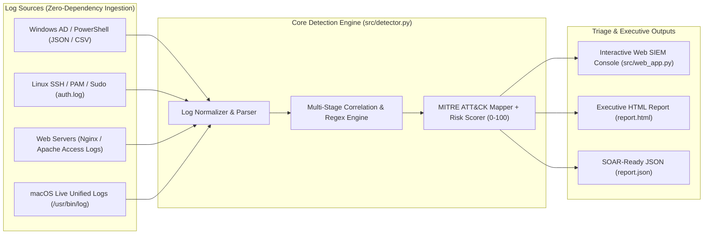

# System Architecture — SOC Log Sentinel

## High-Level Data & Detection Pipeline



## Directory Structure

```text
soc-log-sentinel/
├── .github/workflows/ci.yml        # Automated CI unit tests & smoke tests
├── data/                           # Curated multi-layer sample attack datasets
│   ├── sample_security_events.json # Windows AD multi-stage intrusion
│   ├── sample_linux_auth.log       # Linux SSH + Sudo privilege escalation
│   └── sample_web_access.log       # HTTP SQLi, XSS, Path Traversal & Log4j
├── docs/
│   ├── ARCHITECTURE.md             # System pipeline & directory layout
│   └── PRD_AND_MARKET_ANALYSIS.md  # Product strategy, UK/IE market & personas
├── src/
│   ├── detector.py                 # Core CLI & MITRE ATT&CK correlation engine
│   └── web_app.py                  # Interactive local Web SIEM Console (:8080)
├── tests/
│   └── test_detector.py            # Automated unittest suite (6 test cases)
├── LICENSE                         # MIT License
├── pyproject.toml                  # Python project metadata
└── README.md                       # Documentation & real-world benchmarks
```
